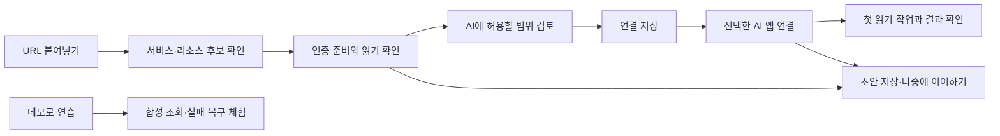

# 등록에서 첫 AI 조회까지: UX 조사와 설계 제안

조사일: 2026-10-10. 상태: **연구·설계 제안, 미구현**.

이 문서는 현재 RC2 화면, 공식 제품 문서, 접근성 가이드, HCI 연구를 함께 검토한 결과다. 기존 코드·설정·릴리스의 동작을 바꾸지 않는다. 확정된 요구는 [결정 기록](UX_DECISIONS_2026-10-10.md), 출처와 읽은 범위는 [근거 목록](UX_SOURCE_NOTES_2026-10-10.md), 버전 관련 발견은 [Dashboard 1.7.0 호환성 메모](DASHBOARD_1_7_COMPATIBILITY.md)에 정리했다.

## 1. 무엇을 성공으로 볼 것인가

성공 기준은 **등록한 서비스에서 AI가 첫 읽기 작업을 수행하고 결과를 보여주는 것**이다. 대상 설정 저장, 토큰 저장, 클라이언트 설정 파일 등록, 로컬 대상 목록 조회는 각각 중간 단계다.

확인된 사용 조건은 다음과 같다.

- 한국어를 기본으로 사용한다. 설정과 운영의 사용 비중은 비슷하다.
- 서비스·저장소·작업 URL을 붙여넣고, 빠진 정보만 추가하고 싶다.
- URL은 알고 있지만 토큰 발급과 권한 선택에는 안내가 필요하다.
- 연결 규모는 환경별 대상을 포함해 1~5개 정도다.
- GitHub Enterprise, Jenkins, Kubernetes Dashboard 모두 첫 조회 흐름을 준비한다.
- Dashboard 화면에 1.7.0이 표시되며, 토큰을 붙여넣는 로그인 화면을 사용한다. 전체 버전인지 별도 web 컴포넌트 버전인지는 미확인이다.
- 중단한 일반 설정은 초안으로 저장하고 나중에 이어간다.
- 실제 사용은 ChatGPT Desktop 또는 Claude Desktop일 가능성이 높다. 현재 지원 CLI 중에서는 Codex CLI를 선호한다.

인증 방법은 특정 방식으로 확정되지 않았다. 우선 서비스별 토큰 발급 안내를 제공하고, 서비스·버전·회사 정책·구현 지원을 확인한 경우에만 브라우저 인증을 추가하는 것을 제안한다.

## 2. 조사 방법과 한계

공식 문서와 원저자·연구기관 자료를 우선했다. 제품 사례는 현재 문서에 설명된 흐름을 비교한 것이며, 모든 제품을 직접 설치해 비교 실험한 결과는 아니다. 2026년 자료와 오래된 가이드를 함께 사용하되 발표 연도와 조사일을 구분했다.

RC2 연결 화면을 브라우저와 소스로 확인했다. 서비스 등록이나 실제 사내 API 조회를 수행하지 않았다. 현재 사용자의 응답은 개인의 요구를 정하는 근거이며 전체 사용자 집단의 통계가 아니다. 논문 전체 정독을 주장하지 않는다. 본문 일부를 읽은 연구와 초록만 읽은 연구를 근거 목록에서 구분했다.

## 3. 현재 화면에서 확인한 마찰

| 관찰 | 사용자에게 생기는 부담 | 설계에서 확인할 것 |
| --- | --- | --- |
| 일반적인 ‘연결 대상 추가’가 GitHub 제목으로 이동한다 | 어떤 서비스를 추가하는지 먼저 정할 수 없다 | URL 입력과 서비스 선택을 하나의 시작점으로 제공 |
| GitHub 주소의 origin과 저장소 이름을 따로 입력한다 | 이미 가진 저장소 URL을 사람이 다시 분해해야 한다 | 붙여넣은 URL에서 후보를 추출하고 수정 가능하게 표시 |
| 인증 필드가 있지만 발급·권한 안내가 등록 흐름 안에 충분히 연결되지 않는다 | 토큰이 없으면 화면 밖에서 무엇을 해야 하는지 찾게 된다 | 발급 위치, 필요한 권한, 관리자 요청 항목을 같은 맥락에 제공 |
| 새 대상의 연결 테스트는 저장 전에는 사용할 수 없다 | 잘못된 설정을 먼저 등록해야 확인할 수 있다 | 비활성 초안 상태에서 확인할 수 있는 백엔드 계약 검토 |
| 대상이 없어도 진단·SSH·Python 관련 카드가 등록 폼보다 앞에 나온다 | 지금 시작해야 할 일과 나중에 가능한 일이 섞인다 | 초기 상태에서 첫 연결을 우선하고 운영 진입은 연결 후에 제시 |
| 기능별 탐색이 여러 페이지로 나뉘어 있다 | 연결 등록 후 AI 앱 설정·첫 조회까지 사용자가 경로를 조립해야 한다 | 등록 완료 다음 행동을 직접 이어주는 안내 |
| 클라이언트 확인과 로컬 카탈로그 호출이 존재한다 | 실제 외부 조회까지 확인했다고 오해할 여지가 있다 | 로컬 설정, 서비스 조회, 사용자 확인의 근거를 분리 |

근거 위치: [연결·등록 폼](../../ui.html), [등록 대상 연결 검사](../../connection_test_tool.go), [준비 상태 화면](../../ui_fragments/readiness.html), [GitHub 합성 첫 사용 검사](../../github_first_use_acceptance_test.go). 준비 상태 화면은 이미 사용자 확인 표시를 앱의 검증과 구분한다. 이 구분을 유지하면서 흐름을 더 쉽게 연결해야 한다.

오류 복구와 초안 이어하기의 사용성은 아직 사용자 실험으로 확인하지 않았다. 아래 개선 효과는 검증할 가설이다.

## 4. 다른 제품에서 가져올 패턴

| 사례 | 확인한 패턴 | 이 앱에 적용할 제안 | 적용 범위의 한계 |
| --- | --- | --- | --- |
| [Claude Desktop Extensions](https://www.anthropic.com/engineering/desktop-extensions) | 패키지 설치, 필요한 설정 입력, OS 비밀 저장소 처리 | AI 앱 연결을 설정 파일 편집보다 설치·연결 경험으로 안내 | 현재 EXE가 검증된 MCPB 패키지라는 뜻은 아님 |
| [VS Code MCP](https://code.visualstudio.com/docs/agent-customization/mcp-servers) | 서버 추가, 신뢰 확인, 도구 발견, 채팅에서 첫 사용 | 설치 성공 뒤 실제 사용 예제를 이어 제공 | 서버 설치와 사내 서비스 권한은 별도 |
| [Docker MCP Toolkit](https://docs.docker.com/ai/mcp-catalog-and-toolkit/toolkit/) | 서비스 선택, 지원 서버의 브라우저 OAuth, 클라이언트 연결 | 인증을 서비스 선택 직후 필요한 맥락에서 안내 | Docker의 컨테이너 격리나 OAuth 지원을 이 앱의 기능으로 간주하지 않음 |
| [Docker Profiles](https://docs.docker.com/ai/mcp-catalog-and-toolkit/profiles/) | 작업별 서버 구성과 클라이언트 연결 | 추후 기존 연결 복제·템플릿 재사용의 참고 | OAuth 자격 증명은 프로필 간 공유됨. 그룹을 계정 격리로 설명하면 안 됨 |
| [n8n Credentials](https://docs.n8n.io/build/understand-workflows/create-and-edit-credentials.md) | 서비스별 인증 설명, 저장 시 자격 증명 테스트 | 발급 도움말을 해당 서비스 입력 필드 옆에 배치 | 자격 증명 테스트가 원하는 리소스 조회 성공까지 증명하지는 않음 |
| [Postman Import](https://learning.postman.com/docs/getting-started/importing-and-exporting/importing-data) | URL·텍스트·기존 형식으로 시작해 편집 가능한 요청으로 전환 | 사용자가 가진 URL을 시작 재료로 활용 | cURL 실행·임의 endpoint 등록은 별도 문제. 1차 범위는 URL 해석 |
| [Grafana TestData](https://grafana.com/docs/grafana/latest/datasources/testdata/) | 외부 연결 없이 합성 데이터로 체험·오류 재현 | 실제 대상이 없어도 첫 조회와 실패 복구를 연습하는 데모 | ‘데모 성공’과 ‘실제 서비스 성공’을 계속 구분 |
| [Tailscale Add device](https://tailscale.com/docs/features/access-control/device-management/how-to/set-up) | 설치·인증·추가와 관리자 승인 대기 상태를 구분 | 관리자 승인 대기나 사내 접속 대기를 중단 가능한 상태로 표현 | 네트워크 제품의 설치 흐름 자체를 복제하지 않음 |

이 사례들이 공통으로 제시하는 방향은 **사용자가 이미 가진 입력에서 시작하고, 준비 과정을 실제 사용으로 연결하는 것**이다. 이는 사례 비교에 따른 설계 해석이며 비교 실험으로 입증한 순위가 아니다.

2026-08-05 [Anthropic 기업 배포 문서](https://support.claude.com/en/articles/12702546-deploying-enterprise-grade-mcp-servers-with-desktop-extensions)는 로컬 확장의 사내 리소스 접근과 관리자 제어를 강조한다. 로컬 설치 경로를 별도로 다루는 근거로 사용하되, 이 앱이 사내 SSO나 브라우저 세션을 자동 재사용한다고 약속하지 않는다.

## 5. 오래된 원칙과 최신 연구를 함께 적용하기

### 필드를 덜 보여주되 필수 판단은 남긴다

[NN/G의 Progressive Disclosure](https://www.nngroup.com/articles/progressive-disclosure/)는 자주 쓰는 기능과 드문 설정을 나누고, 추가 기능으로 가는 경로를 분명히 하도록 권한다. 이 앱에서는 URL·인증·대상 범위가 기본이고, 세부 경로 매핑과 고급 설정은 필요할 때 펼치는 후보가 된다. 인증이나 실제 지원 제약까지 숨겨서는 안 된다.

[GOV.UK 폼 구조 가이드](https://www.gov.uk/service-manual/design/form-structure)는 모든 질문의 필요성을 먼저 검토하고, 조건에 맞는 질문만 노출하도록 권한다. 한 페이지에 한 결정을 두는 방식으로 시작하되 반복 업무에서는 연구를 통해 페이지를 합칠 수 있다고 명시한다. 따라서 첫 등록 안내와 이후 빠른 수정 화면을 같은 길이로 만들 필요는 없다.

### 친절한 폼은 장식보다 오류와 재입력을 줄인다

Seckler 등의 [CHI 2014 폼 연구](https://researchprofiles.ku.dk/en/publications/designing-usable-web-forms-empirical-evaluation-of-web-form-impro/)는 65명 실험에서 여러 가이드를 함께 적용한 폼의 완료 시간·제출 시도·만족도 개선을 보고했다. 이번 조사는 기관 초록만 확인했다. 특정 가이드 하나의 효과나 이 앱의 개선 비율로 해석하지 않는다.

[W3C 다단계 폼 안내](https://www.w3.org/WAI/tutorials/forms/multi-page/)와 [중복 입력 해설](https://www.w3.org/WAI/WCAG22/Understanding/redundant-entry.html)을 참고해 단계·뒤로가기·기존 입력 보존을 설계한다. 보안 또는 정보 만료에 따른 재입력은 별도다. 토큰 원문을 일반 초안에 저장하거나 이전 값을 다시 보여주는 근거로 사용하지 않는다.

### 자동화가 모든 확인을 없애지는 않는다

[Buçinca 등의 2021 연구](https://www.eecs.harvard.edu/~kgajos/papers/2021/bucinca21trust.pdf)는 199명의 영양 판단 과제에서 인지적 개입이 AI 과신을 줄였지만 주관적 사용성에 비용이 생기는 경우를 보고했다. 서비스 등록을 직접 연구한 결과는 아니다.

[Ghosh 등의 2026 연구](https://arxiv.org/html/2601.18033v1)는 고정된 AI 작성 계획에 합성 오류를 넣은 과제를 다뤘다. 계획의 가정을 검토하는 방식과 다른 개입의 효과·부담이 달랐다. 사전 공개 논문이며 서비스 등록에 대한 직접 검증은 아니다.

이 두 연구에서 얻는 설계 가설은 매 필드마다 확인을 반복하기보다 **대상 리소스와 허용 작업을 집중해서 검토하도록 만드는 것**이다. URL에서 추출한 값은 쉽게 수정하게 하고, 빌드 실행 같은 추가 권한은 읽기 권한과 함께 묵시적으로 켜지 않는다. 이는 앱의 기존 정책 경계와도 맞는다.

### 많은 내부 정보보다 다음 행동을 알려준다

[Springer·Whittaker의 2018 연구 초록](https://arxiv.org/abs/1811.02164)은 세분된 피드백이 오히려 산만해질 수 있음을 보고한다. 이 앱에서는 원시 요청 로그 대신 ‘인증 확인 중’, ‘저장소 조회 성공’, ‘권한 확인 필요’와 다음 행동을 기본으로 제시하는 가설을 세운다. 실제 오류나 불확실성을 감추는 방식은 적용하지 않는다.

[Microsoft HAX 연구](https://www.microsoft.com/en-us/research/wp-content/uploads/2019/01/Guidelines-for-Human-AI-Interaction-camera-ready.pdf)의 기대 설정·오류 수정 원칙을 참고해 URL 추론을 확정 사실로 표시하지 않고 수정 경로를 제공한다. [NN/G의 2026 AI Agents as Users](https://www.nngroup.com/articles/ai-agents-as-users/)는 의미 있는 컨트롤과 접근성 구조의 중요성을 강조한다. 이는 사람과 자동화의 탐색을 돕는 전문가 논의이며 권한 판단을 AI에 맡기는 근거는 아니다.

## 6. 비교할 등록 흐름

| 안 | 형태 | 장점 가설 | 비용·검증할 점 |
| --- | --- | --- | --- |
| A. 단계별 안내 | 주소 → 인증 → 범위 확인 → AI 첫 조회 | 토큰 발급처럼 화면 밖 활동이 있는 첫 등록에 맥락을 유지하기 쉬움 | 단계 이동 증가, 복귀 시 값 보존, 진행 표시가 실제 분기와 맞는지 |
| B. 한 화면에서 순차 확장 | URL 아래에 필요한 항목만 펼침 | 전체 설정을 보며 수정·두 번째 연결 등록하기 쉬움 | 좁은 화면에서 길어짐, 열린 영역과 완료 상태의 구분 |
| C. 대화형 보조 | 목표·URL을 입력하면 초안을 제안하고 폼으로 검토 | 사용자가 목적을 자연어로 설명할 수 있음 | 추론 오류, 재현성, 모델 의존, 토큰이 대화로 들어가는 혼동 |

추천 가설은 **첫 등록은 A, 기존 연결 수정·복제는 B, C는 선택 보조**다. 대화형 보조를 기본 등록의 필수 의존성으로 두지 않는다. 시각적 방향과 최종 화면 형식은 아직 확정하지 않았다. 다음 검토에서는 동일한 과제를 가진 A/B 화면을 비교한다.

### 제안 흐름

이 도식은 설계 제안이다. 원격 연결 확인은 사용자가 대상·확인 작업을 보고 실행한 뒤 시작한다. URL을 붙여넣거나 단계를 열었다는 이유만으로 원격 요청을 보내지 않는다. 설정 저장 전 검사를 하려면 현재 ‘저장된 대상만 검사’ 계약과 분리된 비활성 초안 검사 계약이 필요하다.

## 7. 세 서비스의 첫 조회와 인증 안내

| 서비스 | 사용자가 가진 입력 | 부족할 때 안내할 정보 | 첫 읽기 과제 후보 |
| --- | --- | --- | --- |
| GitHub Enterprise | 저장소 URL | 서버 버전, 토큰 발급 위치, 지정 저장소 접근과 endpoint별 필요 권한, 조직 승인 여부 | 등록한 저장소의 기본 정보와 기본 브랜치 조회 |
| Jenkins | 작업 URL | 서버 기본 주소·폴더 작업 분리, 계정명과 API 토큰 발급, 해당 작업 읽기 권한 | 등록한 작업의 상태 또는 최근 빌드 조회 |
| Dashboard 1.7.0 | Dashboard URL | 프록시 접두 경로, 인증 토큰 종류, 버전 호환 모드, 선택 리소스의 읽기 권한 | 등록 범위 내 namespace 또는 지정 Deployment 상태 조회 |

[GitHub Enterprise Server 문서](https://docs.github.com/en/enterprise-server@3.22/authentication/keeping-your-account-and-data-secure/managing-your-personal-access-tokens)는 토큰 종류·리소스 범위·조직 승인과 endpoint별 필요 권한을 구분한다. 조사한 3.22의 기능을 버전 미확인 서버에 그대로 약속하지 않는다. 기본 정보 조회의 권한을 확인한 뒤 추가 콘텐츠 조회는 별도 권한으로 안내한다.

[Jenkins 인증 문서](https://www.jenkins.io/doc/book/system-administration/authenticating-scripted-clients/)는 계정명과 API 토큰을 사용하고 개인 보안 설정에서 토큰을 확인하도록 안내한다. 버전별 메뉴 차이와 회사 권한 정책은 별도다. 첫 과제에서는 빌드 실행을 요구하지 않는다. [Jenkins API 문서](https://www.jenkins.io/doc/book/using/remote-access-api/)의 작업별 경로 구조를 URL 해석에 참고한다.

Dashboard의 구형 전체 v1.7.0 코드와 현재 Bearer 안내 사이에 불일치가 발견됐다. 별도 web/v1.7.0도 존재하므로 화면 표시만으로 사용자의 backend 계약을 확정할 수 없다. [호환성 메모](DASHBOARD_1_7_COMPATIBILITY.md)의 설치 식별·검증 항목을 해결하기 전에는 ‘로그인 결과를 붙여넣으면 된다’고 안내하지 않는다. 전체 namespace 목록 권한이 없더라도 지정된 리소스 읽기가 가능할 수 있으므로 목록 실패 하나로 모든 조회를 불가능하다고 판정하지 않는 설계를 검토한다.

## 8. 데스크톱 앱 연결을 별도 경험으로 설계

현재 코드의 자동 등록 대상은 CLI 중심이다. 사용자의 선호에 맞춰 ChatGPT Desktop과 Claude Desktop을 각각 안내할 필요가 있다.

- [현재 OpenAI MCP 문서](https://learn.chatgpt.com/docs/extend/mcp?surface=cli)는 **동일 Codex host**의 ChatGPT Desktop·Codex CLI·IDE 확장이 설정을 공유하고 stdio 서버를 지원한다고 설명한다. 등록 파일 확인만으로 특정 Desktop 대화에서 실제 도구 호출이 성공했다고 판단하지 않는다. 설치된 앱·실행 환경에서 별도 검증한다.
- [Claude Desktop 공식 안내](https://support.claude.com/en/articles/10949351-getting-started-with-local-mcp-servers-on-claude-desktop)는 로컬 확장과 binary MCP 서버, 사용자 정의 MCPB 설치를 설명한다. 현재 앱에는 검증된 Desktop 설치 패키지가 없다. 기존 Credential Manager 참조를 유지하며 실행 파일을 패키징하는 방법과 업데이트 동작을 검토한다.
- 두 Desktop의 설치 화면과 첫 조회 안내는 각각 준비한다. Claude Code CLI 설정을 Claude Desktop 연결 완료로 표시하지 않는다.

원격 웹 플러그인 경로와 로컬 stdio 경로를 동일하게 취급하지 않는다. 이 UX 개선을 위해 현재 loopback 앱을 자동으로 외부에 공개할 필요는 없다.

## 9. 준비 상태가 답해야 하는 질문

한 개의 초록색 ‘준비 완료’ 대신 다음 근거를 짧게 보여준다. 내부 상태 수와 실제 화면 단계 수는 같을 필요가 없다.

| 상태 | 근거 | 사용자에게 보여줄 행동 |
| --- | --- | --- |
| 초안 | 일반 설정을 로컬에 보관, MCP 실행 범위에는 없음 | 이어서 설정 / 초안 삭제 |
| 인증 준비 필요 | 사용할 비밀 참조가 없거나 발급·승인 대기라고 사용자가 보고 | 발급 안내 / 관리자 요청 내용 확인 |
| 서비스 읽기 확인 | 선택한 리소스의 제한된 원격 조회가 성공 | 조회 시각·범위 확인 / 범위 변경 |
| 연결 저장 | 저장된 대상과 허용 작업이 유효 | AI 앱 연결로 이동 |
| AI 앱 설정 확인 | 해당 앱의 등록 정보를 검사 | 새 세션 안내 / 도구 확인 |
| 첫 조회 확인 | MCP 읽기 호출 성공을 앱이 관찰하거나 클라이언트 결과를 사용자가 보고 | 근거 종류·시각을 표시하고 다음 작업 제안 |
| 확인 필요 | 설정 변경·만료·조회 실패 또는 근거 없음 | 실패 원인별 다음 행동 / 재확인 |

‘앱이 관찰한 MCP 호출’과 ‘사용자가 AI 앱에서 결과를 봤다고 보고함’을 구분한다. MCP 호출만으로 호출한 앱의 정체나 AI가 결과를 올바르게 해석했다는 사실까지 증명하지 않는다. 결과 본문·토큰·로그를 장기 저장해 증거를 만드는 방식은 채택하지 않는다. 설정이나 비밀 참조가 바뀌면 이전 성공 표시를 현재 상태의 보증으로 사용하지 않는다.

## 10. 한국어 문구와 오류 복구

한국어 기본값 외에도 용어를 사용자의 행동에 맞춘다. ‘HTTPS origin’은 기본 화면에서 ‘서비스 주소’로 설명하고 필요한 경우 도메인만 사용하는 이유를 덧붙인다. ‘MCP’는 AI 앱이 사용할 도구 연결이라는 설명과 함께 보조 위치에 둔다. 서비스명·리소스명은 번역하지 않는다.

| 상황 | 문구 초안 | 다음 행동 |
| --- | --- | --- |
| 주소 입력 | ‘서비스나 저장소 주소를 붙여넣으세요.’ | 서비스 인식 결과 수정 |
| 인증 미준비 | ‘토큰이 없어도 주소를 초안으로 저장할 수 있어요.’ | 발급 안내 / 초안 저장 |
| 실패 원인 미확정 | ‘조회하지 못했어요. 입력한 주소는 남아 있어요.’ | 주소·접속·권한 확인 항목 펼치기 |
| 인증 응답 실패 | ‘입력한 인증 정보로 조회하지 못했어요.’ | 토큰 종류·만료·권한 점검 |
| 권한 부족 가능성 | ‘이 리소스에 접근할 수 없어요. 계정 권한과 승인 상태를 확인해 주세요.’ | 서비스별 확인 안내 |
| 저장 성공 | ‘연결을 저장했어요. 이제 AI 앱에서 첫 조회를 해보세요.’ | 선택한 앱 연결·예시 요청 |
| 데모 성공 | ‘데모 조회가 끝났어요. 실제 서비스 연결은 아직 확인하지 않았어요.’ | 실제 연결 추가 |

[GOV.UK 오류 안내](https://design-system.service.gov.uk/components/error-message/)를 참고해 오류를 해당 필드와 연결하고 입력을 보존한다. 네트워크 실패를 사용자의 입력 오류로 단정하지 않는다. Jenkins는 403만으로 잘못된 토큰과 권한 부족을 구분할 수 없다는 점도 반영한다. [접근 가능한 인증 해설](https://www.w3.org/WAI/WCAG22/Understanding/accessible-authentication-minimum)을 참고해 토큰 붙여넣기를 막지 않는다. 이 문서 자체는 WCAG 준수 인증이 아니다.

## 11. 실제 대상 없이 준비할 검증

### 합성 환경과 자동 검사

- URL 해석: GitHub 저장소·하위 페이지, Jenkins context path·중첩 job, Dashboard 프록시 prefix·SPA fragment. 불명확한 서비스는 후보만 제안한다.
- 입력 보호: credentials가 포함된 URL, 인코딩된 경로, query의 비밀 후보, 지원하지 않는 scheme. 원문을 로그·초안·AI 요청에 남기지 않는지 확인한다.
- 초안: 앱 재시작·뒤로가기·단계 전환 후 일반 설정 유지, 초안이 MCP 실행 대상으로 노출되지 않음, 수정 시 이전 확인 상태 해제.
- 인증: 토큰 누락·만료·권한 부족·승인 대기·잘못된 응답 형식·프록시 로그인 HTML·TLS 실패. HTTP 코드 하나만으로 원인을 확정하지 않음.
- Dashboard: 실제 backend 식별 계약과 구형 전체 v1.7.0 공식 코드에 맞춘 Bearer/JWE 분리 fixture, 제한된 GET 경로. 구형 fixture 성공과 실제 설치 호환 검증을 별도로 표시.
- 첫 사용: 로컬 카탈로그 성공과 외부 읽기 성공을 다른 상태로 처리. AI 앱의 등록 성공을 서비스 성공으로 승격하지 않음.
- 데모: 화면 전체에 데모 표시, 실제 프로필·비밀값을 건드리지 않는 분리된 데이터, 성공·실패·복구 과제 제공.
- 접근성: 키보드 이동, 각 단계 제목과 focus, 오류 연결, 완료 상태 읽기, 좁은 창·확대·한국어 긴 문구에서 동작.

이 목록은 새 흐름의 테스트 계획이다. 이번 문서 작성에서 해당 테스트를 구현하거나 실행하지 않았다. 기존 합성 검사와 중복되는 부분은 재사용하고, 실제 오류·상태 전이·정보 노출을 검증하는 검사만 추가한다.

### 사람에게 확인할 과제

1. 설명 없이 주소를 붙여넣고 어떤 서비스·리소스가 등록되는지 말하기.
2. 토큰이 없는 상황에서 발급·권한 선택의 다음 행동 찾기.
3. 승인 또는 접속 대기로 중단한 뒤 초안을 다시 열기.
4. 선택한 AI 앱에서 첫 읽기 결과를 확인하고 준비 상태의 근거 설명하기.
5. 데모 성공과 실제 조회 성공을 구별하기.

현재 화면과 A/B 흐름에서 도움 없이 완료했는지, 막힌 지점, 불필요한 수동 분해·재입력, 오류 후 회복, 과제 후 체감 난이도를 기록한다. 인증 대기·사내 VPN 등 외부 대기 시간과 앱 안의 작업 시간을 분리한다. 초기 3~5명의 관찰은 문제를 찾기 위한 계획이며, 모집·실험을 수행하지 않았고 통계적 우월성이나 특정 완료 시간 목표를 입증하지 않는다.

## 12. 우선순위와 다음 산출물

| 순서 | 산출물 | 완료 판정 |
| --- | --- | --- |
| P0 | Dashboard 1.7.0 인증 계약 확인, Desktop별 연결 경로 정리 | 토큰 종류·헤더·설정 범위가 출처와 코드에서 일치, 실제 미검증 범위 표시 |
| P0 | 세 서비스의 URL 시작·인증 도움·범위 확인·첫 조회 화면 설계 | 사용자 과제로 A/B 비교 가능, 기본 화면에서 다음 행동을 찾을 수 있음 |
| P0 | 비활성 초안과 첫 사용 상태 계약 | 초안은 실행되지 않음, 상태별 근거·실패·변경 무효화 정의 |
| P1 | 합성 데모·실패 fixture·초안 복구 검사 | 실제 대상 없이 성공·실패·이어하기를 재현 가능 |
| P1 | ChatGPT Desktop 검증과 Claude Desktop 설치 경로 검증 | 각 앱에서 별도로 도구와 외부 읽기 관찰, 지원 버전 기록 |
| P1 | 기존 연결 수정·복제·인증 참조 재사용 | 일반 설정 재입력 감소, 리소스·작업 권한은 다시 검토 |
| P2 | 팀 템플릿·고급 일괄 관리 | 1~5개 흐름을 검증한 뒤 실제 필요가 확인될 때 진행 |

다음 단계는 세 서비스의 동일한 첫 사용 과제를 담은 화면안을 비교하는 것이다. 연구 제안과 사용자 확정 요구를 구분해 구현 범위를 정하고, 이후 기존 설정·비밀 참조·서버 정책을 보존하며 변경한다.
